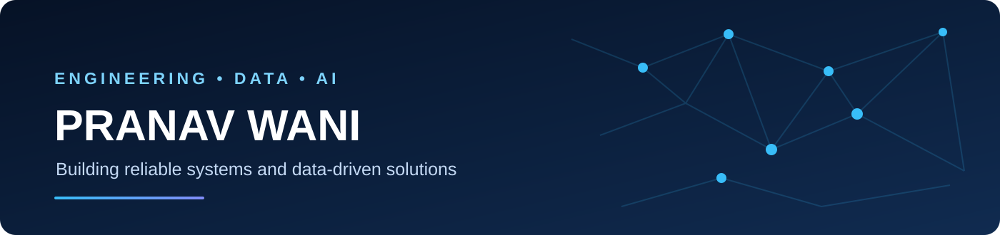

<h1 align="center">Hi, I'm Pranav Wani 👋</h1>

<b>Data Engineer | Python | Backend Systems | AI & Data</b>

## 👋 About Me

I'm a **Data Engineer** with an M.S. in Information Technology from **The University of Texas at San Antonio**. I build data workflows, backend services, and practical applications that turn complex information into useful solutions. My work combines **Python, SQL, REST APIs, ETL/data quality, and applied AI/ML**. I enjoy collaborating on real-world problems and building software that is maintainable, testable, and useful.

## 🚀 Featured Projects

<table>
<tr><td width="50%" valign="top"><h3>🚗 <a href="https://github.com/wanipranav/Safe-Drive">Safe-Drive</a></h3>
Real-time driver drowsiness detection using computer vision and backend communication.
Python · OpenCV · FastAPI · WebSockets</td><td width="50%" valign="top"><h3>🎙️ <a href="https://github.com/wanipranav/Voice2Code">Voice2Code</a></h3>
Speech-to-code application that converts spoken instructions into Python code.
Python · Speech Recognition</td></tr>
<tr><td valign="top"><h3>❤️ <a href="https://github.com/wanipranav/Heart-Failure-Prediction">Heart Failure Prediction</a></h3>
Predictive machine-learning project exploring classification and feature reduction.
Python · Machine Learning · PCA</td><td valign="top"><h3>📄 <a href="https://github.com/wanipranav/Resume-Analyzer-Job-Match">Resume Analyzer</a></h3>
Analyzing resumes and matching candidate information with job requirements.
Python · NLP</td></tr>
</table>

**More work:** [Secure Medical Data Processing](https://github.com/wanipranav/Secure-Medical-Data-Processing) · [All repositories](https://github.com/wanipranav?tab=repositories) · [Hackathon projects on Devpost](https://devpost.com/wanipranav)

## 💼 Experience

**Data Engineer — Better Futures Institute** · San Antonio, TX  
- Clean and standardize healthcare, demographic, and socioeconomic datasets with Python.
- Support data services and dashboards for community-focused analytics.

**Graduate Teaching Assistant — University of Texas at San Antonio**  
- Supported programming, data structures, object-oriented design, and debugging.

**Program Analyst — WNS Global Services**  
- Worked on ETL workflows, data quality, reporting, and documentation.

## 🎓 Education

- **Master of Science in Information Technology** — University of Texas at San Antonio · GPA: 4.00/4.00
- **Bachelor of Engineering in Information Technology** — Savitribai Phule Pune University

## 📜 Certifications

- Python for Data Science, AI & Development
- ETL Data in Power BI
- Data Analysis with Microsoft Excel
- Harnessing the Power of Data with Power BI

## 🛠️ Skills

`Python` · `SQL` · `FastAPI` · `PostgreSQL` · `ETL/ELT` · `Pandas` · `Docker` · `REST APIs` · `Machine Learning` · `Git`

<i>Building reliable systems · Turning data into insights · Creating meaningful impact</i>

